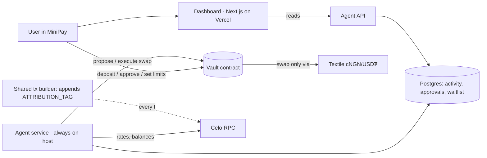

# NairaGuard design

The build spec for Cursor. Work through the **Build order** one task at a time; each task lists what "done" means.

## What it is
An AI agent that protects Nigerian freelancers and small businesses from naira losses. Users deposit cNGN and USD₮ into a vault on Celo. They set a target mix and limits. The agent watches the rate and rebalances by swapping on **Textile** (cNGN/USD₮ only), explaining every trade in plain English. The dashboard runs as a **MiniPay mini app**.

Hackathon: Celo "Agents on Open Rails", Textile FX track. Deadline 9 Nov 2026, 10:00 WAT.



## Hard rules
1. **Every transaction is tagged.** Agent and dashboard both send through one tx builder that appends `ATTRIBUTION_TAG` (`celo_9efd0f97b491`). A test fails if any tx is built without it.
2. **The vault, not the agent, enforces limits.** If the agent key is compromised, it still can't exceed what the user set.
3. **Swaps only through Textile.** The vault holds an allowlist of Textile contract addresses set by the owner.
4. **Approvals expire on-chain.** An expired approval can never execute.
5. **No secrets in the repo.** It's public.

## Networks
| | Chain id | RPC |
|---|---|---|
| Celo Sepolia (testnet) | 11142220 | https://forno.celo-sepolia.celo-testnet.org |
| Celo mainnet | 42220 | https://forno.celo.org |

Token and Textile addresses go in `agent/src/config.ts` per network. **TBD**: confirm Textile contract addresses, swap interface, and testnet availability with Textile (office hours Thursdays 12:00 GMT). Until then, the vault uses a mock swap router on Sepolia.

### Celo Sepolia deployments (PR #13, Ownable2Step)
| | Address |
|---|---|
| Vault | `0xD436aA344C0E2a58a607443680651a2c32066be6` |
| Mock cNGN | `0xaA3B7364E418deC4Fb147f1BD2d95A4022082aEA` |
| Mock USDT | `0xe123971ec3F56138766272B7b15Ee188fdD0eFf7` |
| Mock router | `0xd834aB4e7caDc62f2E27ab6755ED4B22F0461e86` |
| Agent | `0xa2a173a481bc063fee0ef11c67fc756dc5f928f4` |

Recorded in `deployments/celo-sepolia.json` and `agent/src/config.ts`. The previous vault `0xA47F3e8b08a94D1933e2031416d54640A0BEF63B` is retired. Before mainnet, transfer vault ownership from the deployer to the user's wallet (`transferOwnership` + `acceptOwnership`).

## 1. Vault contract (`contracts/src/Vault.sol`)

Roles: `owner` (the user), `agent` (agent wallet, set by owner).

State
- `mapping(address token => bool) supported` (cNGN, USD₮)
- `mapping(address router => bool) swapRouters` (Textile only)
- `Limits { uint256 maxTradeUsd; uint256 maxDailyUsd; uint256 approvalThresholdUsd; uint16 maxSlippageBps; uint16 targetNgnBps; }`
- `dailySpentUsd`, `dayStart`
- `Approval { address tokenIn; address tokenOut; uint256 amountIn; uint256 minOut; uint64 expiresAt; bool executed; }` keyed by id

Functions
- `deposit(token, amount)` / `withdraw(token, amount, to)` (owner only; withdraw always works, even when paused)
- `setLimits(Limits)`, `setAgent(address)`, `setSwapRouter(address, bool)`, `pause()` / `unpause()` (owner)
- `swap(tokenIn, tokenOut, amountIn, minOut, usdValue)` (agent): reverts if paused, router not allowed, over `maxTradeUsd`, over `maxDailyUsd`, or `usdValue >= approvalThresholdUsd`
- `proposeSwap(...) returns (id)` (agent) for trades above the threshold; sets `expiresAt`
- `approve(id)` (owner) executes it; reverts if expired or already executed
- Events: `Deposited`, `Withdrawn`, `Swapped(id, tokenIn, tokenOut, amountIn, amountOut)`, `SwapProposed(id, expiresAt)`, `LimitsUpdated`, `Paused`

Note: `usdValue` comes from the agent; the contract also checks `minOut` against `maxSlippageBps`. A price oracle check is a stretch goal.

## 2. Agent service (`agent/`)

Loop, every N minutes:
1. Read cNGN/USD₮ rate (Textile quote) and vault balances.
2. Compute current NGN share vs `targetNgnBps`. If drift > band (e.g. 5%), size a rebalance trade within limits.
3. Write a plain-English reason, e.g. "Naira share was 72%, target 50%. Moved ₦400,000 to USD₮ at ₦1,520/$."
4. Below threshold: `swap`. Above: `proposeSwap` and wait for the user.
5. Record everything in Postgres.

Modules: `config.ts`, `txBuilder.ts` (the only place that sends txs), `textile.ts`, `strategy.ts` (pure function, unit-tested), `loop.ts`, `api.ts`.

Strategy must be sensible, not random: Textile FX judges on P&L, volume and originality.

## 3. API (agent serves, dashboard reads)

All amounts are strings (token base units). Every value has NGN and USD equivalents plus the rate used.

```ts
type Money = { token: 'cNGN' | 'USDT'; amount: string; amountNgn: string; amountUsd: string; rate: string; rateAt: string };

GET  /api/vault/:address/balances  -> { balances: Money[]; ngnShareBps: number; targetNgnBps: number }
GET  /api/vault/:address/activity  -> { items: { id: string; kind: 'swap'|'deposit'|'withdraw'; in?: Money; out?: Money; reason: string; txHash: string; status: 'pending'|'confirmed'|'failed'; at: string }[] }
GET  /api/vault/:address/approvals -> { items: { id: string; in: Money; minOut: Money; reason: string; expiresAt: string }[] }
GET  /api/vault/:address/limits    -> Limits
GET  /api/agent                    -> { address: string; erc8004Id?: string; lastRunAt: string; healthy: boolean }
GET  /api/waitlist/nonce?address=0x… -> { nonce; expiresAt; message? }   // one-time, 10 min, stored in Postgres
POST /api/waitlist?source=…        { contact, consent, wallet?, fromMiniPay? } -> { ok: true; signupToken; verified: false }
POST /api/waitlist/verify          { signupToken, message, signature } -> { ok: true; verified: true }   // SIWE (EIP-4361)
```

`balances` also returns `pnlNgn`, `pnlUsd` (strings, 2dp) and `pnlSince` (ISO date the vault was first seen funded, or null).
P&L = vault value now in ₦ − starting balances valued at the current rate (no trading). Real balances are used, so swap fees/slippage are already netted. Every agent tick logs a row in `quotes`; each confirmed swap also gets `fee_ngn` (value change across the swap at one rate) and `pnl_ngn` on its `activity` row.

Waitlist SIWE uses `WAITLIST_CHAIN_ID` (default 42220, Celo mainnet), separate from the agent's `NETWORK`; signatures are verified with a read-only Celo mainnet client (https://forno.celo.org, override `WAITLIST_RPC_URL`) so smart-wallet / EIP-1271 checks work. Domain comes from `DASHBOARD_URL`.

Waitlist verification: users can join without signing (`verified = false`). To verify, the client fetches a nonce, the wallet signs the SIWE message (domain = dashboard host, chain id, nonce, expiry), and `/verify` checks it with `viem/siwe` `verifySiweMessage`, consumes the nonce once (replays and expired messages are rejected), then sets `verified = true` and stores the recovered address.

`signupToken` is 32 crypto-random bytes (hex), returned only once by `POST /api/waitlist`; the server stores only its sha256 (`signup_token_hash`). `/verify` finds the signup by that hash (never by a client-supplied id) and only updates it if `wallet_address` is null or already equals the signer (case-insensitive), otherwise `409 wallet_mismatch`. The client must keep the token from the join response and send it to `/verify`.

Writes (approve, set limits, deposit, withdraw) are **signed by the user's wallet in MiniPay**, sent through the tx builder, not via the API.

## 4. Data (Postgres)
- `activity` (vault, kind, amounts, rate, reason, tx_hash, status, created_at)
- `approvals` (vault, onchain_id, amounts, reason, expires_at, status)
- `waitlist` (id, email, phone, wallet_address, verified bool, from_minipay bool, source, consent bool, created_at).
  - **source allowlist:** `x`, `celo-ng`, `celo-africa-dao`, `minipay`, `whatsapp-freelancers`, `referral`. Anything else, or missing, stores as `direct`.
  - **verified:** the client must never send a verified flag. Store the address plus whether it came from MiniPay. Real verification is Task 5: the user signs a short message in MiniPay and the server recovers the signer; only then set `verified = true`. Only verified addresses count toward the independent-user check (active on Celo before 6 Oct). Never put signups in seeds or logs.

### Independent-user count
`agent/scripts/count-independent.ts` counts verified waitlist wallets that are independent. It drops a wallet when:
1. it is in `excluded_wallets` (`reason`: `team`, `test`, `funded_by_us`);
2. it ever received CELO or tokens (normal, token or internal transfers) from the deployer, the agent, or any `team` wallet;
3. it received funds from a wallet that itself was directly funded by the deployer, agent or a `team` wallet (one hop). These are flagged `funded_indirect`, listed separately for **manual review**, and not counted. Guards: a wallet is an intermediary only if it paid out to ≤ 20 distinct addresses (`--max-fanout` / `MAX_FANOUT`), and never if it is in `agent/config/exchange-allowlist.json` (known exchange / on-ramp hot wallets, verified via Blockscout labels; currently empty). The output lists every intermediary used with its payee count;
4. its first Celo mainnet activity is on/after the cutoff, or it has none. Cutoff defaults to `2026-10-05T23:00:00Z` (6 Oct 00:00 WAT); override with `--cutoff <ISO>` or `INDEPENDENT_CUTOFF`.

Blockscout calls are cached per address and list for the run, and pagination is capped at `BLOCKSCOUT_MAX_PAGES` (default 5 × 1000 rows per list). Very busy wallets may be truncated past that cap.
Data comes read-only from `celo.blockscout.com/api` (Etherscan-compatible). Output: a table plus JSON (totals, `byReason`, and each dropped address with its reason). No contacts are printed.

```bash
cd agent && DATABASE_URL=… pnpm tsx scripts/count-independent.ts [--json]
# add an excluded wallet (then counts):
DATABASE_URL=… pnpm tsx scripts/count-independent.ts --exclude 0xabc… --reason funded_by_us --note "airdropped gas"
```
Or in SQL: `INSERT INTO excluded_wallets (address, reason, note) VALUES (lower('0xABC…'), 'test', 'why') ON CONFLICT (address) DO NOTHING;`

## 5. MiniPay
- Connect via the injected provider; the wallet address is the identity. No separate login.
- Fees paid in stablecoin (fee currency) so users don't need CELO. **TBD**: confirm MiniPay's current requirements before Task 6.
- HTTPS only (Vercel previews per PR).

## 6. ERC-8004 and attribution
Source: [Celo ERC-8004 docs](https://docs.celo.org/build/agents/8004).
- Agent wallet: `0xa2a173a481bc063fee0ef11c67fc756dc5f928f4`. It registers, so it owns the identity (hard to undo). Use only this wallet.
- Identity Registry (mainnet 42220): `0x8004A169FB4a3325136EB29fA0ceB6D2e539a432`. Reputation Registry: `0x8004BAa17C55a88189AE136b182e5fdA19dE9b63`.
- Call `register(string agentURI)` from the agent wallet **through the tx builder** (tagged). It mints an ERC-721 to the sender and emits `Registered(agentId, agentURI, owner)`. Store `agentId` in config and add it to the card.
- `agentURI` = `https://<dashboard>/.well-known/agent.json` with `type`, `name`, `description`, `image`, `endpoints` (dashboard URL, `wallet` with chainId 42220). Card must be live before registering.
- Show the identity on the dashboard via `/api/agent`.

## Build order (one Cursor task at a time)
1. **Vault + tests.** Implement section 1 with a mock Textile router. Done when `forge test` covers: deposit/withdraw, every limit revert, router allowlist, propose/approve/expiry, pause. Deploy to Celo Sepolia.
2. **Tx builder.** `agent/src/txBuilder.ts` appends `ATTRIBUTION_TAG`. Done when a test proves every built tx carries it.
3. **Strategy.** Pure `strategy.ts` with unit tests for drift, sizing, limits.
4. **Agent loop on Celo Sepolia** with Postgres activity log. Done when it makes and logs trades against the Sepolia vault.
5. **API** per section 3, with tests. Include waitlist POST: source allowlist → `direct`, and MiniPay signature verification before setting `wallet_verified`.
6. **Dashboard wiring** to the API following `docs/ui-spec.md`, MiniPay connect.
7. **Loss-example script**: compute the real ₦ loss on ₦500,000 over last month from rate data for the waitlist page.
8. **Textile integration**: swap mock router for real Textile once addresses are confirmed.
9. **Mainnet**: deploy vault (owner approval), fund agent, register ERC-8004, first tagged trades. Target 28 Oct.
